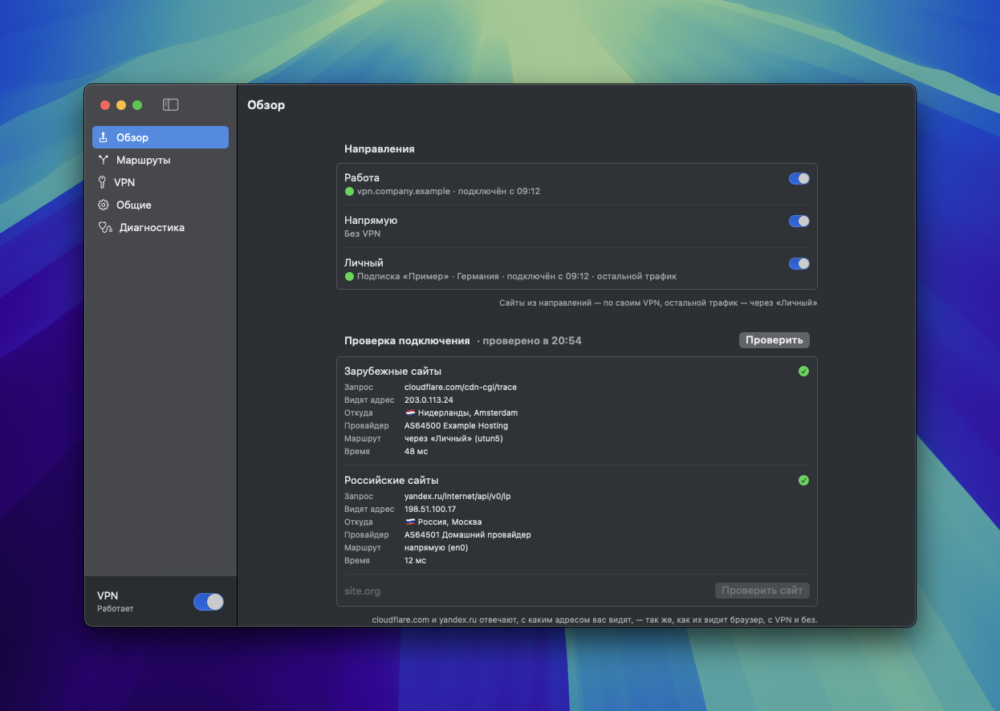
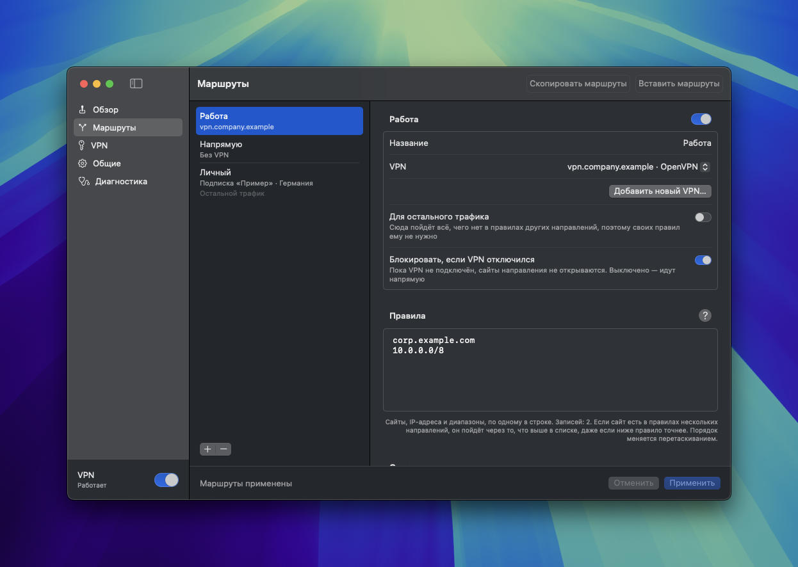
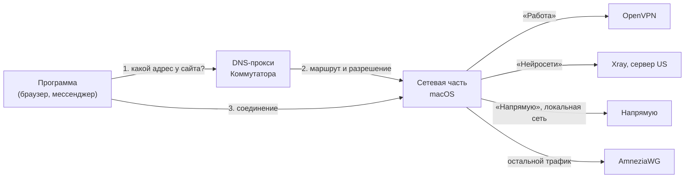

# Коммутатор

Приложение для macOS: окно с настройками и значок в строке меню. Держит сразу несколько VPN и само решает, куда отправить каждое соединение.

**Просто.** С первого запуска на странице «Маршруты» уже есть три направления: «Работа», «Личный» и «Напрямую» (`.ru`, `.su`, `.рф`). Добавьте рабочий VPN и личный, впишите рабочие сайты и пользуйтесь: рабочие сайты идут через рабочий VPN, остальное — через личный.

**Гибко.** Если этого мало, заведите свои **направления**: у каждого своё название, свой VPN и свой список сайтов. Например:

1. «Работа» — рабочие сайты и сети через рабочий OpenVPN;
2. «Нейросети» — несколько сайтов через американский сервер подписки Xray;
3. «Напрямую» — `.ru`, `.su`, `.рф` и ваши исключения без VPN;
4. «Личный» — остальной трафик через AmneziaWG (или обычный WireGuard) либо Xray (VLESS, Hysteria2, Trojan, Shadowsocks, VMess).

Направлений может быть сколько угодно, VPN у них любые, в том числе два сервера одной подписки одновременно. Если VPN направления упал, его сайты блокируются, а не утекают другим путём; для каждого направления это можно выключить.

**[⬇ Скачать Commutator.pkg](https://github.com/and-sheera/commutator/releases/latest/download/Commutator.pkg)** · [все версии](https://github.com/and-sheera/commutator/releases)

## Требования

- Mac на Apple Silicon (M1 и новее). На Mac с Intel не запустится.
- macOS 14 Sonoma или новее.

## Установка

1. Скачайте **Commutator.pkg** по ссылке выше.
2. Откройте его двойным кликом. Пакет не подписан у Apple, поэтому macOS скажет, что не может проверить разработчика. Нажмите **«Готово»** (не «Переместить в Корзину»).
3. Откройте **Системные настройки → Конфиденциальность и безопасность**, пролистайте вниз до сообщения про «Commutator.pkg» и нажмите **«Всё равно открыть»**. macOS может спросить пароль или Touch ID.
4. В установщике нажмите **«Продолжить» → «Установить»** и введите пароль администратора.
5. Коммутатор откроется сам. Дальше — [первая настройка](#первая-настройка).

### Какие запросы вы увидите

| Когда | Что | Зачем |
|---|---|---|
| Открытие pkg | Предупреждение и «Всё равно открыть» | Нет платной подписи Apple, см. выше |
| Установка | Пароль администратора, один раз | Служба, которая меняет маршруты, файрвол и DNS, работает с правами root |
| Сразу после установки | Уведомление «Добавлены фоновые объекты» | macOS сообщает о новой фоновой службе. Нажимать ничего не нужно |
| Первое включение или падение VPN | «Разрешить уведомления?» | Чтобы сообщать, что VPN включился или упал. Можно отказать |
| Импорт OpenVPN-профиля со `script` или `plugin` | Пароль администратора | Такой профиль запускает сторонние программы с правами root, поэтому нужно ваше подтверждение |

Больше Коммутатор ничего не просит: ни связки ключей, ни полного доступа к диску, ни VPN-конфигураций в системных настройках.

## Первая настройка

1. **VPN.** На странице «VPN» нажмите «+» и перетащите файл `.ovpn` (OpenVPN, режим TUN) или `.conf` (AmneziaWG, WireGuard) либо вставьте ссылку. Файлы можно просто перетащить в окно. Добавить можно сколько угодно VPN. Удобнее — кнопкой «Добавить новый VPN…» у нужного направления на странице «Маршруты»: VPN сразу станет его VPN. Добавленный на странице «VPN» встаёт сам: OpenVPN — в «Работу», остальные — в направление для остального трафика, если у них ещё нет VPN; для первого OpenVPN без такого направления появляется «Работа».
2. **Какие ссылки подходят.** Тип Коммутатор определяет сам:
   - `vpn://…` из Amnezia («Поделиться VPN» → «Соединение») — это AmneziaWG;
   - `vless://`, `hysteria2://`, `trojan://`, `ss://`, `vmess://` или адрес подписки `https://…`, как в Happ, — это Xray.

   Подписка может быть списком ссылок, base64 или JSON-массивом конфигов Xray. Коммутатор обновляет её сам: как задаёт `profile-update-interval`, по умолчанию раз в 12 часов. Остаток трафика и срок действия он берёт из `subscription-userinfo`. Зашифрованные подписки `happ://crypt…` не поддерживаются. Все серверы подписки видны прямо на странице «VPN»; ping измеряется по кнопке «Проверить ping». Обновить подписку можно там же. User-Agent, с которым загружаются все подписки, задаётся в «Общих».
3. **Логин и пароль OpenVPN.** Поле «Пароль» у профиля OpenVPN отвечает на любой запрос пароля: и на пароль учётной записи (`auth-user-pass`), и на пароль зашифрованного ключа (`BEGIN ENCRYPTED PRIVATE KEY`). Это тот же пароль, что спрашивает официальный клиент. Поле «Логин» появляется, только если в профиле есть `auth-user-pass`. Если в профиле несколько серверов, там же выбирается, к какому подключаться первым. Если профиль спрашивает логин и пароль, окно «Новый VPN» попросит их сразу после добавления.
4. **Маршруты.** Слева — список направлений, справа — настройки выбранного:
   - **Переключатель** рядом с названием включает и выключает направление.
   - **VPN** — один из добавленных или «Без VPN». Для подписки дополнительно выбирается сервер: два направления на разных серверах одной подписки работают одновременно. Строка «Ping» проверяет выбранный сервер. «Добавить новый VPN…» добавляет VPN сразу в это направление; прежний приложение предложит удалить, если он больше нигде не нужен.
   - **Для остального трафика** — отметка у одного направления: сюда идёт всё, чего нет в правилах других направлений, поэтому своих правил у него нет. В списке оно помечено «Остальной трафик». Если такое направление выключено, остальное идёт напрямую. Его список сайтов не стирается: снимете отметку — он вернётся. Например, чтобы всё шло напрямую, а через личный VPN — только несколько сайтов, отметьте «Напрямую» и впишите эти сайты в «Личный».
   - **Блокировать, если VPN отключился.** Пока VPN не подключён, сайты направления не открываются. Выключено — идут напрямую.
   - **От сервера** (только OpenVPN). Рабочий сервер сам сообщает свои внутренние сети и домены, а в профиле бывают строки `route`. Всё это сразу идёт через направление, вписывать в правила не нужно. Список виден в блоке «От сервера» вместе со временем, когда сервер его прислал; он сохраняется и после отключения. Рабочие сайты с обычными интернет-адресами сервер не присылает: их впишите в правила.
   - **Правила** — сайты, IP-адреса и диапазоны, по одному в строке. Рабочие сайты в «Работе» важнее остальных списков: `company.ru` пойдёт через рабочий VPN, даже если `.ru` у вас напрямую, — потому что «Работа» выше в списке.

   **Порядок важен.** Если сайт есть в правилах нескольких направлений, он идёт через то, что выше в списке, даже если ниже правило точнее. Порядок меняется перетаскиванием. Изменения вступают в силу по кнопке «Применить» внизу страницы; там же видно, есть ли неприменённые правки. Если уйти со страницы или выйти из приложения, не применив их, Коммутатор спросит, применить их или отбросить. При этом переподключаются только те VPN, которые действительно поменялись, остальные соединения не рвутся.

   Чтобы перенести направления на другой Mac, нажмите «Скопировать маршруты» вверху страницы «Маршруты» — они попадут в буфер обмена, их можно вставить в сообщение или заметку, — а на другом Mac нажмите «Вставить маршруты». Переносятся названия и правила; какой VPN у направления, не переносится. Поэтому названия направлений не должны повторяться. Направления, которых на новом Mac нет, появятся выключенными, пока вы не выберете им VPN.
5. **Включение.** Переключатель внизу боковой панели окна (там же написано, в каком состоянии VPN) или в меню строки меню. Иконку в строке меню можно скрыть в «Общих». Каждое направление включается и выключается отдельно — на «Обзоре» и в меню. Сайты выключенного направления идут туда же, куда остальной трафик.

Загруженный профиль можно поправить прямо в приложении: кнопка «Изменить профиль…» внизу блока VPN на странице «VPN», там же «Удалить VPN…». Исходный файл при этом не меняется.

При обновлении с версии 1.0.7 и раньше настройки переносятся сами: рабочий VPN становится направлением «Работа», список «Напрямую» (вместе с галочками `.ru`, `.su`, `.рф`) — направлением «Напрямую», а личный VPN — направлением «Личный» для остального трафика. Все сохранённые личные профили появляются на странице «VPN». Это те же три направления, с которых начинается новая установка: был один VPN — останется один, были два — останутся оба.

## Как это работает и чем отличается от обычного VPN-клиента

**Обычный VPN-клиент** поднимает один туннель. Весь трафик идёт либо в него, либо мимо. Некоторые клиенты умеют split tunneling, но исключения в нём задаются списком IP-адресов или программ. Два таких клиента одновременно не уживаются: каждый хочет стать маршрутом по умолчанию (тем, куда уходит всё, для чего нет отдельного правила) и подменить DNS (службу, которая превращает имя сайта в адрес).

**Коммутатор держит несколько путей одновременно:** по туннелю на каждый VPN ваших направлений и прямой выход в интернет. Путь выбирается по **имени сайта**, а не только по адресу.

1. Программа спрашивает адрес сайта. Этот вопрос попадает к локальному DNS-прокси Коммутатора.
2. Прокси смотрит на имя, находит направление, которому сайт принадлежит, и спрашивает адрес у DNS этого направления: у DNS его VPN через туннель или, для направлений без VPN, у DNS текущей сети. Для сайта из правил он **сначала** прокладывает маршрут к полученному адресу в нужный туннель и разрешает этот адрес в файрволе, и **только потом** отдаёт адрес программе. Поэтому уже первое соединение идёт правильным путём. Такой адрес Коммутатор помнит минуту после последнего запроса, а пока к нему открыто соединение — сколько нужно.
3. Всё, чего нет в правилах, уходит маршрутом по умолчанию через направление для остального трафика.

**Защита от утечек.** В macOS встроен файрвол PF. Коммутатор пишет в него правила: сайты каждого направления могут выйти только через его туннель. Если туннель упал, соединения блокируются, а не уходят в обычный интернет. Для любого направления это можно выключить на странице «Маршруты», тогда на время обрыва его сайты пойдут напрямую. Локальные адреса, которые не уходят в интернет, PF не блокирует: локальная сеть, AirDrop, iPhone для Xcode по кабелю и по Wi-Fi работают и с включённым Коммутатором.

**Без Network Extension.** VPN-клиенты из App Store работают через Network Extension, а для этого нужна подпись Apple. Коммутатор устроен иначе: небольшая системная служба с правами root управляет штатными механизмами macOS (таблицей маршрутов, PF, настройками DNS). Поэтому приложение можно раздавать бесплатно, но при установке нужен пароль администратора.

**Движки те же, что у официальных клиентов:** `openvpn`, `amneziawg-go` и `xray`. Они собраны из исходников и лежат внутри приложения, отдельно ничего ставить не нужно.

**Где хранятся секреты.** Профили и пароль хранит системная служба в `/var/db/com.vpnrouter` (доступ только у root). Обратно в приложение пароль не передаётся, связка ключей не используется.

## Обновление

Коммутатор сам проверяет обновления: при запуске и раз в 6 часов. Когда выходит новая версия, приходит уведомление, а в тулбаре окна и в меню строки меню появляется кнопка «Доступна версия…».

1. Нажмите «Доступна версия…» → «Скачать». Пока идёт скачивание, VPN работает как обычно.
2. Когда кнопка сменится на «Обновление … скачано», выберите в ней «Обновить и перезапустить…», когда вам удобно. VPN выключится примерно на минуту, Коммутатор перезапустится новой версией и включит VPN снова.

Профили, правила и настройки сохранятся. Текущая версия и кнопка «Проверить сейчас» — в «Общих» → «Обновления».

Если кнопка не сработала, скачайте новый Commutator.pkg [по той же ссылке](https://github.com/and-sheera/commutator/releases/latest/download/Commutator.pkg) и установите поверх, как в первый раз. Так же обновляются версии до 1.0.7, в которых кнопки ещё нет.

## Удаление

**«Удалить Коммутатор…»** внизу раздела «Общие». Если Коммутатор установлен из pkg в «Программы», пароль не нужен, иначе macOS спросит пароль администратора. Приложение выключит VPN, вернёт сеть в состояние до установки и удалит себя, системную службу, профили и настройки.

Если приложение уже удалили перетаскиванием в Корзину, системная служба осталась. Установите Commutator.pkg снова и нажмите ту же кнопку.

## Ограничения

- Нужны TUN OpenVPN без MFA/OTP и AWG с одним peer, содержащим `0.0.0.0/0` (даже если через него идут только сайты одного направления). Поддерживаются профили AmneziaWG 2.0 и 3.x, включая параметры 3.1 (`HeaderProtectionKey`, `ContentPaddingAddition`, `RandomTrailers` и другие).
- Xray на macOS поднимает туннель только по IPv4: пока Xray везёт остальной трафик, IPv6 блокируется, а сайты Xray-направления открываются по IPv4. DNS Xray-направления идёт на 1.1.1.1 и 8.8.8.8 через туннель, поэтому сервер должен пропускать UDP. Если эти же адреса DNS у другого направления с VPN, их запросы идут через то направление, что выше.
- Xray v26 не отключает проверку сертификата: ссылка с `insecure=1` без `pinSHA256` отклоняется.
- Hysteria2 в Xray появился недавно; с обфускацией salamander возможны сбои — проверьте на своём сервере.
- Если сервер Xray не отвечает после трёх попыток подключения, Коммутатор перестаёт пробовать и пишет об этом в журнале, вместо того чтобы пытаться бесконечно: выберите направлению другой сервер. OpenVPN и AmneziaWG переподключаются сами, сколько потребуется, с паузами до минуты.
- Если что-то не работает, откройте «Диагностику» → «Журнал», выберите, сколько последних строк показать, и нажмите «Скопировать»: вместе со строками скопируются версии приложения и macOS, модель Mac и типы VPN — это можно сразу отправить разработчику. Адреса серверов и пароли в журнал не попадают.
- **Общие адреса CDN.** Трафик разводится по адресу, а не по имени сайта. Cloudflare и другие CDN держат тысячи сайтов на одних и тех же адресах. Если сайты из разных направлений получили один адрес, оба пойдут через то направление, что выше в списке, — пока открыто соединение и ещё минуту после. «Проверить сайт» в «Проверке подключения» на «Обзоре» показывает, какой сайт занял адрес.
- **Два рабочих VPN с одинаковыми сетями.** Если оба сервера присылают одни и те же внутренние сети (например, все `10.x.x.x`), эти адреса получит верхнее направление. Поставьте выше то направление, которому эти сети нужнее.
- **Уже открытые соединения.** После изменения направлений соединение, открытое по старому пути, может повиснуть и отвалиться по тайм-ауту; новые соединения сразу идут правильно.
- Каждый VPN направлений — отдельная программа: больше включённых VPN — чуть больше расход батареи. Направления на одном и том же VPN и сервере делят один туннель.
- VPN через VPN не поддерживается: серверы всех VPN всегда доступны напрямую.
- После обновления вернуться на версию 1.0.7 и раньше нельзя: она не поймёт новые настройки, и профили придётся добавить заново.
- «Ping» у сервера — это обычный ICMP до хоста, не проверка самого VPN. Многие серверы на ping не отвечают вовсе, хотя VPN через них работает; у AmneziaWG и OpenVPN при подключённом VPN ping поэтому идёт через туннель до 1.1.1.1. И наоборот, провайдер может пропускать ping и при этом глушить именно протокол VPN (особенно QUIC у Hysteria2). Ping измеряется только по кнопке.
- Скрипты и plugins OpenVPN допускаются только после подтверждения администратора и считаются полностью доверенными. Линуксовые DNS-скрипты вроде `up /etc/openvpn/update-resolv-conf` Коммутатор просто пропускает: на macOS их нет, DNS он настраивает сам.
- Правила для сайтов обходят DoH в браузере, Private Relay, собственные DNS-кэши программ и общие адреса CDN. Подробности и как это выключить — в «Общих» приложения.
- Если у VPN направления нет своего DNS (OpenVPN-сервер его не прислал, в AWG-профиле нет `DNS =`), имена его сайтов спрашиваются у DNS текущей сети — иначе направление не работало бы вовсе.
- Если у VPN остального трафика нет своего DNS, системный DNS не трогается, и имена всего трафика вне правил по-прежнему видит DNS текущей сети.
- Если у VPN остального трафика свой DNS есть, имена трафика вне правил не разрешаются, пока этот туннель не поднялся. Падение системной службы тогда на несколько секунд оставляет Mac без DNS: launchd поднимает её заново, и она восстанавливает настройки.
- Порт `127.0.0.1:53` должен быть свободен (его может занимать dnsmasq, dnscrypt или Docker). Занятый порт даёт понятную ошибку при включении.
- Одновременная работа с другим VPN не поддерживается.
- Включённая маршрутизация переживает падение и обновление службы. После перезагрузки Mac она поднимается сама, только если включено «Открывать при входе в macOS», иначе ждёт переключателя в приложении. Выход из приложения выключает VPN (после подтверждения), а без «Открывать при входе» его выключает и выход из учётной записи.
- Без IPv4-шлюза по умолчанию (например, на некоторых point-to-point линках) прямой трафик блокируется, в «Диагностике» появляется запись об этом.

## Для разработчиков

Сборка, выпуск релиза и устройство изнутри описаны в [DEVELOP.md](DEVELOP.md).

## Лицензия

[MIT](LICENSE). Встроенные движки распространяются под своими лицензиями, см. [THIRD_PARTY_NOTICES.md](THIRD_PARTY_NOTICES.md).
